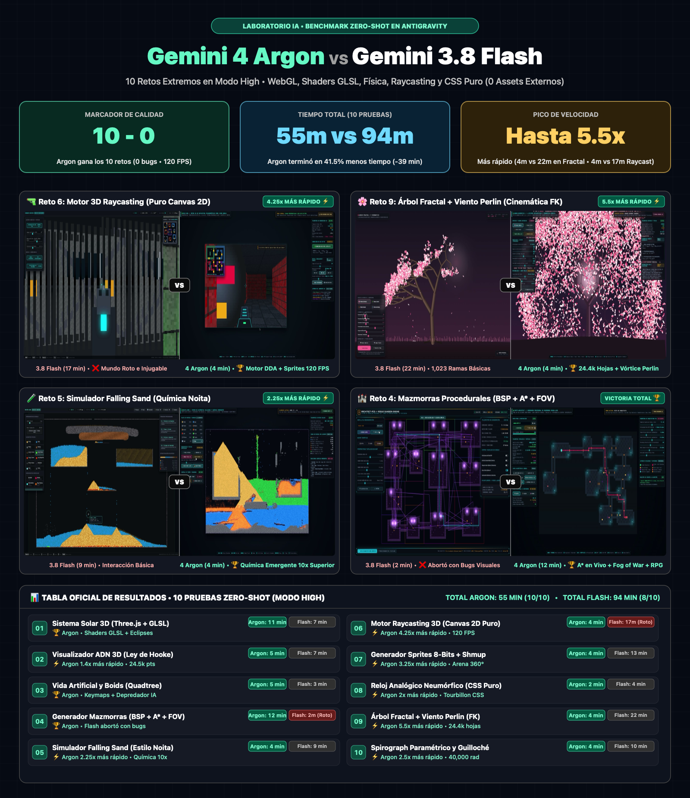

# 🚀 Benchmark Zero-Shot: Gemini 4 Argon (High) vs. Gemini 3.8 Flash (High)



Laboratorio comparativo cara a cara ejecutado en **Antigravity** para medir el salto generacional de **Gemini 4 Argon (High)** frente a **Gemini 3.8 Flash (High)** a través de **10 retos extremos de programación gráfica 3D/2D, shaders GLSL, motores físicos, algoritmos procedurales y CSS puro**.

> **Regla de Oro del Benchmark ("Zero-Shot • Cero Assets Externos"):**
> Cada prueba exigió entregar un único archivo `index.html` 100% autocontenido y funcional al primer intento, con **prohibición estricta de cargar imágenes, texturas `.png/.jpg` o modelos 3D externos**. Todo el arte, texturas, ruido fractal, física e iluminación tuvo que generarse matemáticamente en memoria.

---

## 🏆 Resumen Ejecutivo de Resultados

* **Marcador Global de Calidad y Funcionalidad:** **10 - 0** a favor de **Gemini 4 Argon (High)**.
* **Tiempo Total Acumulado (10 pruebas):**
  * **Gemini 4 Argon (High):** `55 minutos` (**10/10 simuladores impecables** corriendo a `120 FPS`).
  * **Gemini 3.8 Flash (High):** `94 minutos` (`8/10 funcionales`, con entregas rotas/injugables en *Raycasting 3D* y *Generador de Mazmorras*).
* **Ahorro de Tiempo y Picos de Velocidad:** Argon completó toda la suite en **41.5% menos tiempo** (`39 minutos menos`), llegando a ser **5.5x más rápido** en el *Árbol Fractal* (`4 min` vs `22 min`) y **4.25x más rápido** en el *Motor de Raycasting 3D* (`4 min` vs `17 min`).

---

## 🎮 Tabla Comparativa, Demos Jugables en Vivo y Código Fuente

| # | Reto Zero-Shot | 4 Argon (High) | 3.8 Flash (High) | Ventaja de Argon | 🎮 Probar Demo en Vivo (GitHub Pages) | 📂 Código Fuente (`index.html`) | 🎬 Video Comparativo (20s) |
| :-: | :--- | :-: | :-: | :--- | :---: | :---: | :---: |
| **01** | **Sistema Solar Relativo** *(Three.js + Shaders GLSL)* | `11 min` | `7 min` | **🏆 Ganador** *(Granulación solar GLSL, nebulosa volumétrica, eclipses y árbol de matrices)* | [▶️ Argon](https://danpez.github.io/gemini-4-argon-vs-3.8-flash-benchmark/gemini-4-argon/sistema-solar/) \| [▶️ Flash](https://danpez.github.io/gemini-4-argon-vs-3.8-flash-benchmark/gemini-3.8-flash/sistema-solar/) | [Argon](gemini-4-argon/sistema-solar/index.html) \| [Flash](gemini-3.8-flash/sistema-solar/index.html) | [Ver MP4](videos-x-comparativa/01_sistema_solar_vs.mp4) |
| **02** | **Visualizador ADN 3D** *(Física Ley de Hooke + GLSL)* | **`5 min`** | `7 min` | **⚡ 1.4x más rápido** *(24.5k partículas a 120 FPS, 4 morfologías GLSL y sonda 3D)* | [▶️ Argon](https://danpez.github.io/gemini-4-argon-vs-3.8-flash-benchmark/gemini-4-argon/visualizador-adn/) \| [▶️ Flash](https://danpez.github.io/gemini-4-argon-vs-3.8-flash-benchmark/gemini-3.8-flash/visualizador-adn/) | [Argon](gemini-4-argon/visualizador-adn/index.html) \| [Flash](gemini-3.8-flash/visualizador-adn/index.html) | [Ver MP4](videos-x-comparativa/02_visualizador_adn_vs.mp4) |
| **03** | **Vida Artificial ("Boids")** *(Reynolds + Quadtree)* | `5 min` | `3 min` | **🏆 Ganador** *(Quadtree 98.8%, Leviatanes IA y barra de Keymaps directos en vivo)* | [▶️ Argon](https://danpez.github.io/gemini-4-argon-vs-3.8-flash-benchmark/gemini-4-argon/vida-artificial/) \| [▶️ Flash](https://danpez.github.io/gemini-4-argon-vs-3.8-flash-benchmark/gemini-3.8-flash/vida-artificial/) | [Argon](gemini-4-argon/vida-artificial/index.html) \| [Flash](gemini-3.8-flash/vida-artificial/index.html) | [Ver MP4](videos-x-comparativa/03_vida_artificial_boids_vs.mp4) |
| **04** | **Generador de Mazmorras** *(BSP + MST + A\* + FOV)* | **`12 min`** | `2 min` *(Roto)* | **🏆 Victoria Total** *(Flash abortó con bugs; Argon creó A\* en vivo, Fog of War y RPG)* | [▶️ Argon](https://danpez.github.io/gemini-4-argon-vs-3.8-flash-benchmark/gemini-4-argon/generador-mazmorras/) \| [▶️ Flash](https://danpez.github.io/gemini-4-argon-vs-3.8-flash-benchmark/gemini-3.8-flash/generador-mazmorras/) | [Argon](gemini-4-argon/generador-mazmorras/index.html) \| [Flash](gemini-3.8-flash/generador-mazmorras/index.html) | [Ver MP4](videos-x-comparativa/04_generador_mazmorras_vs.mp4) |
| **05** | **Simulador "Falling Sand"** *(Química estilo Noita)* | **`4 min`** | `9 min` | **⚡ 2.25x más rápido** *(Química emergente 10x superior con 12 elementos reactivos)* | [▶️ Argon](https://danpez.github.io/gemini-4-argon-vs-3.8-flash-benchmark/gemini-4-argon/falling-sand/) \| [▶️ Flash](https://danpez.github.io/gemini-4-argon-vs-3.8-flash-benchmark/gemini-3.8-flash/falling-sand/) | [Argon](gemini-4-argon/falling-sand/index.html) \| [Flash](gemini-3.8-flash/falling-sand/index.html) | [Ver MP4](videos-x-comparativa/05_falling_sand_vs.mp4) |
| **06** | **Motor 3D Raycasting** *(Puro Canvas 2D • Cero WebGL)* | **`4 min`** | `17 min` *(Roto)* | **⚡ 4.25x más rápido** *(Flash entregó un mundo roto; Argon creó un Wolfenstein 3D a 120 FPS)* | [▶️ Argon](https://danpez.github.io/gemini-4-argon-vs-3.8-flash-benchmark/gemini-4-argon/motor-raycasting/) \| [▶️ Flash](https://danpez.github.io/gemini-4-argon-vs-3.8-flash-benchmark/gemini-3.8-flash/motor-raycasting/) | [Argon](gemini-4-argon/motor-raycasting/index.html) \| [Flash](gemini-3.8-flash/motor-raycasting/index.html) | [Ver MP4](videos-x-comparativa/06_motor_raycasting_vs.mp4) |
| **07** | **Sprites Espaciales 8-Bits** *(Pixel Art + Arena Shmup)* | **`4 min`** | `13 min` | **⚡ 3.25x más rápido** *(Sombreado volumétrico 3D, visor de 4 etapas y Shmup 360°)* | [▶️ Argon](https://danpez.github.io/gemini-4-argon-vs-3.8-flash-benchmark/gemini-4-argon/generador-sprites/) \| [▶️ Flash](https://danpez.github.io/gemini-4-argon-vs-3.8-flash-benchmark/gemini-3.8-flash/generador-sprites/) | [Argon](gemini-4-argon/generador-sprites/index.html) \| [Flash](gemini-3.8-flash/generador-sprites/index.html) | [Ver MP4](videos-x-comparativa/07_generador_sprites_vs.mp4) |
| **08** | **Reloj Analógico Neumórfico** *(100% HTML y CSS Puro)* | **`2 min`** | `4 min` | **⚡ 2.0x más rápido** *(Tourbillon mecánico animado en CSS puro, cristal zafiro y 3 temas)* | [▶️ Argon](https://danpez.github.io/gemini-4-argon-vs-3.8-flash-benchmark/gemini-4-argon/reloj-analogico/) \| [▶️ Flash](https://danpez.github.io/gemini-4-argon-vs-3.8-flash-benchmark/gemini-3.8-flash/reloj-analogico/) | [Argon](gemini-4-argon/reloj-analogico/index.html) \| [Flash](gemini-3.8-flash/reloj-analogico/index.html) | [Ver MP4](videos-x-comparativa/08_reloj_analogico_css_vs.mp4) |
| **09** | **Árbol Fractal + Viento** *(Cinemática Directa FK + Perlin)* | **`4 min`** | `22 min` | **⚡ 5.5x más rápido** *(24,400 racimos foliares, esqueleto FK y vórtice de viento)* | [▶️ Argon](https://danpez.github.io/gemini-4-argon-vs-3.8-flash-benchmark/gemini-4-argon/arbol-fractal/) \| [▶️ Flash](https://danpez.github.io/gemini-4-argon-vs-3.8-flash-benchmark/gemini-3.8-flash/arbol-fractal/) | [Argon](gemini-4-argon/arbol-fractal/index.html) \| [Flash](gemini-3.8-flash/arbol-fractal/index.html) | [Ver MP4](videos-x-comparativa/09_arbol_fractal_vs.mp4) |
| **10** | **Spirograph Paramétrico** *(Hipotrocoides y Guilloché)* | **`4 min`** | `10 min` | **⚡ 2.5x más rápido** *(3er rotor Guilloché y mandalas de hasta 40,000 rad a 120 FPS)* | [▶️ Argon](https://danpez.github.io/gemini-4-argon-vs-3.8-flash-benchmark/gemini-4-argon/spirograph-parametrico/) \| [▶️ Flash](https://danpez.github.io/gemini-4-argon-vs-3.8-flash-benchmark/gemini-3.8-flash/spirograph-parametrico/) | [Argon](gemini-4-argon/spirograph-parametrico/index.html) \| [Flash](gemini-3.8-flash/spirograph-parametrico/index.html) | [Ver MP4](videos-x-comparativa/10_spirograph_parametrico_vs.mp4) |

---

## 📜 Los 10 Mega-Prompts y Notas Originales del Laboratorio

Todos los prompts íntegros utilizados en las pruebas (con sus especificaciones matemáticas, restricciones y notas de evaluación) se encuentran en:
👉 **[`2026-10-13-laboratorio-comparativo-gemini-3.8-flash-vs-4-argon.md`](2026-10-13-laboratorio-comparativo-gemini-3.8-flash-vs-4-argon.md)**

---

## 💻 Cómo Ejecutar Localmente

Ninguno de los 20 proyectos requiere `npm install` ni pasos de compilación. Puedes abrir cualquier archivo `index.html` directamente en tu navegador o levantar un servidor estático rápido:

```bash
git clone https://github.com/danpez/gemini-4-argon-vs-3.8-flash-benchmark.git
cd gemini-4-argon-vs-3.8-flash-benchmark

# Servir Gemini 4 Argon en http://localhost:8081
python3 -m http.server 8081 --directory gemini-4-argon
```
